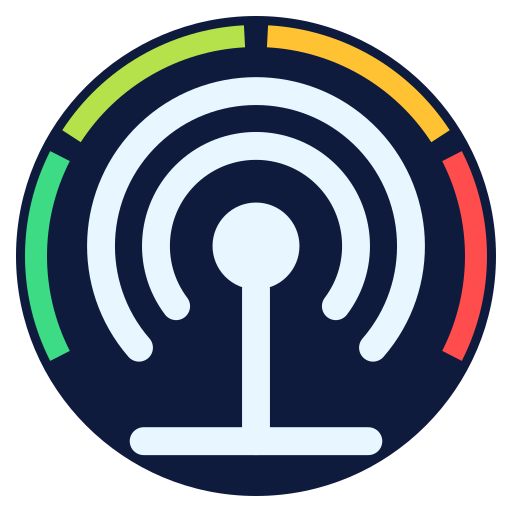

# ISP Network Tester

A lightweight network testing system for measuring connectivity and download throughput between an Android device and a test server hosted inside an ISP network.

The project consists of two components:

- **Android app** — runs ICMP ping tests and HTTP download speed tests, and lets users configure the test server and ping target.
- **Go server** — provides a health endpoint and streams test data to clients.

The measurements describe the path between the Android device and the configured test server. They do not represent general Internet transit performance.

## Components

- [Android application](android/README.md) — requirements, build instructions, features, and tests.
- [Go test server](server/README.md) — configuration, HTTP endpoints, Docker image, and deployment guidance.

## Quick start

1. Deploy the Go server inside the ISP network. See the [server documentation](server/README.md).
2. Build and install the Android application. See the [Android documentation](android/README.md).
3. Configure the server address and port in the app, then run a download or ping test.

The default server port is `8080`.

## Project status

The project is under active development. See the component documentation for current functionality and instructions.
